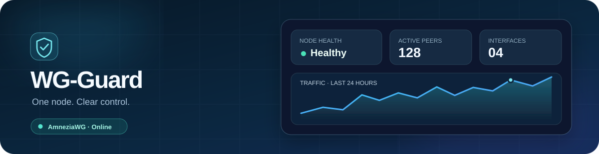

<div align="center" dir="rtl">
  <a href="https://github.com/Sir-Adnan/wg-guard"></a>
  <h1>وی‌گارد · WG-Guard</h1>
  <p><strong>پنلی خوش‌ساخت برای مدیریت نود AmneziaWG شما.</strong></p>
  <p>یک فایل اجرایی Go · پایگاه SQLite · رابط رندرشده روی سرور · استقرار Docker · رابط REST</p>
  <p><strong>فارسی</strong> · <a href="README.md">English</a></p>
  <p>
    <a href="https://github.com/Sir-Adnan/wg-guard/releases/latest"></a>
    
    
    <a href="LICENSE"></a>
  </p>
</div>

وی‌گارد یک نود VPN را از یک پنل واکنش‌گرا و دوزبانه اداره می‌کند: اینترفیس، کاربر، دستگاه،
تحویل کانفیگ، مسیریابی، پشتیبان و به‌روزرسانی. معماری‌اش سبک می‌ماند: Go، SQLite، صفحه‌های
رندرشده روی سرور و HTMX. مسیر دادهٔ VPN روی خود میزبان است و پنل فقط آن را سامان می‌دهد.

> [!NOTE]
> **تازه‌های نسخهٔ v0.2.0:** مسیریابی خروجی از WARP یا کانفیگ WireGuard/AmneziaWG واردشده با
> توزیع بار و قوانین، تست سایت از هر خروجی، پل اختیاری IPv6 برای سایت‌ها، سامانهٔ طراحی تازه با
> ۲۹ تم و چهار طرح برای صفحهٔ اشتراک. جزئیات در [فهرست تغییرات](CHANGELOG.md).

## امکانات

| | |
|---|---|
| 🛡️ **مدیریت AmneziaWG** | اینترفیس با بازه‌های IPv4 مرتب، پروفایل‌های ضد DPI، همتاها و همگام‌سازی کنترل‌شدهٔ میزبان |
| 🧭 **مسیریابی خروجی** | خروج از WARP، کانفیگ WireGuard/AmneziaWG واردشده یا IP مبدأ؛ توزیع بار؛ قوانین مرتب با الگوهای آماده و داده‌های geo؛ تست سایت از هر خروجی |
| 👥 **کاربران** | قالب، حجم و افزایش حجم، انقضا، آغاز از نخستین اتصال، دستگاه، سقف سرعت، بازنشانی مصرف و پلن بعدی |
| 📱 **تحویل به کلاینت** | کانفیگ و کد QR هر دستگاه، دانلود گروهی، افزودن با یک لمس به AmneziaVPN و صفحهٔ اشتراک با چهار طرح و راهنمای هر برنامه |
| 📈 **دید عملیاتی** | سلامت نود و تونل، پردازنده، حافظه، دیسک، نرخ زنده، تاریخچهٔ ترافیک و عیب‌یابی |
| 🔐 **عملیات امن** | دسترسی جداگانهٔ مالک و رسیلر، توکن API سطح‌بندی‌شده، وبهوک امضاشده، پشتیبان رمزنگاری‌شده، به‌روزرسانی و بازگشت |
| 🌐 **رابط پخته** | فارسی و انگلیسی، راست‌به‌چپ و چپ‌به‌راست، روشن و تیره، ۲۹ تم، دسکتاپ و موبایل |

## شروع سریع

روی یک سرور تازهٔ **اوبونتو ۲۴٫۰۴ با پردازندهٔ amd64** و دسترسی root یا sudo:

```bash
bash -o pipefail -c 'curl -fsSL https://raw.githubusercontent.com/Sir-Adnan/wg-guard/main/install.sh | bash'
```

نصب‌کنندهٔ راهنما آخرین نسخهٔ منتشرشده را نصب می‌کند. اول فایل‌های نسخه را بررسی می‌کند و بعد
محیط Docker، حساب مالک و دسترسی پنل را آماده می‌کند. اگر نصب نیمه‌کاره ماند، با
`sudo wg-guard` ادامه دهید. نصب‌کننده و ترمینال فقط انگلیسی‌اند.

| دسترسی به پنل | چه زمانی |
|---|---|
| **تونل خصوصی SSH** | هنوز دامنه ندارید؛ پنل فقط روی loopback می‌ماند |
| **HTTPS مدیریت‌شده** | دامنه یا گواهی IP عمومی دارید؛ وی‌گارد خودش TLS را اداره می‌کند |
| **پراکسی معکوس موجود** | از قبل Nginx یا پراکسی HTTPS دیگری دارید |

<details>
<summary><strong>روش‌های دیگر نصب</strong></summary>

یک نسخهٔ منتشرشدهٔ مشخص (`vX.Y.Z` را جایگزین کنید):

```bash
bash -o pipefail -c 'curl -fsSL https://raw.githubusercontent.com/Sir-Adnan/wg-guard/main/install.sh | bash -s -- --release vX.Y.Z'
```

نسخهٔ توسعه از شاخهٔ `main` (برای تولید تأیید نشده):

```bash
bash -o pipefail -c 'curl -fsSL https://raw.githubusercontent.com/Sir-Adnan/wg-guard/main/install.sh | bash -s -- --commit main'
```

خواندن اسکریپت پیش از اجرا:

```bash
curl -fsSLo wg-guard-install.sh https://raw.githubusercontent.com/Sir-Adnan/wg-guard/main/install.sh
less wg-guard-install.sh && bash wg-guard-install.sh
```

نصب خودکار، commit مشخص و جزئیات صحت‌سنجی در
[راهنمای نصب](docs/operations/github-install.md) آمده است.

</details>

## گام‌های اول

1. داشبورد را ببینید یا `sudo wg-guard doctor` را اجرا کنید.
2. یک اینترفیس با پروفایل ساده یا AmneziaWG بسازید.
3. کاربر اضافه کنید و کد QR، کانفیگ یا لینک اشتراک دستگاه را بفرستید.
4. اختیاری: در بخش **مسیریابی** یک خروجی WARP بسازید و سرویس‌های دلخواه را از آن عبور دهید.

## اداره

```bash
sudo wg-guard             # management menu
sudo wg-guard status      # service and deployment
sudo wg-guard doctor      # host and tunnel diagnostics
sudo wg-guard logs        # recent operational logs
sudo wg-guard update      # update or roll back panel and core
```

پشتیبان رمزنگاری‌شده، بازگردانی، زمان‌بندی، تغییر دسترسی و حذف هم در منو هستند. پیش از انتقال
به سرور تازه پشتیبان بگیرید؛ [راهنمای پشتیبان و بازیابی](docs/operations/backup-restore.md) را ببینید.

## محدودهٔ پشتیبانی

روی اوبونتو ۲۴٫۰۴ با پردازندهٔ amd64، استقرار Docker و هر دو پیاده‌سازی کرنل و userspace
AmneziaWG آزموده شده است. پروفایل‌های AmneziaWG به کلاینت سازگار نیاز دارند و پروفایل ساده با
کلاینت‌های معمولی WireGuard کار می‌کند. نسخه‌های جدیدتر اوبونتو، پردازنده‌های غیر amd64 و
firewalld فعال هنوز پشتیبانی نمی‌شوند. مسیریابی خروجی آزمون خودکار و namespace دارد، اما
ترافیک واقعی کلاینت از آن روی سرور واقعی هنوز تأیید نشده است. همهٔ خانه‌های تأییدشده در
[جدول وضعیت](docs/development/status.md) آمده‌اند.

## یکپارچه‌سازی

`/api/v1` رابط REST مستندی است با توکن سطح‌بندی‌شده، صفحه‌بندی cursor، خرید idempotent، جداسازی
رسیلرها و وبهوک امضاشده. از [قرارداد API](docs/architecture/api.md) و
[قرارداد وبهوک](docs/integrations/webhooks.md) شروع کنید.

## مستندات

[نصب](docs/operations/github-install.md) ·
[استقرار و HTTPS](docs/operations/deployment.md) ·
[مسیریابی خروجی](docs/architecture/egress-routing.md) ·
[سازگاری کلاینت‌ها](docs/integrations/amneziawg.md) ·
[امنیت](docs/operations/security.md) ·
[همهٔ مستندات](docs/README.md)

هر [نسخهٔ منتشرشده](https://github.com/Sir-Adnan/wg-guard/releases/latest) فایل اجرایی
Linux/amd64، ایمیج runtime، checksumها، SBOM و گواهی‌های attestation را دارد. برای بررسی دانلود:
`sha256sum --check --ignore-missing checksums.txt`.

وی‌گارد با [مجوز MIT](LICENSE) منتشر می‌شود. اجزای بیرونی در [THIRD_PARTY.md](THIRD_PARTY.md)
فهرست شده‌اند. مشارکت با [AGENTS.md](AGENTS.md) آغاز می‌شود.
